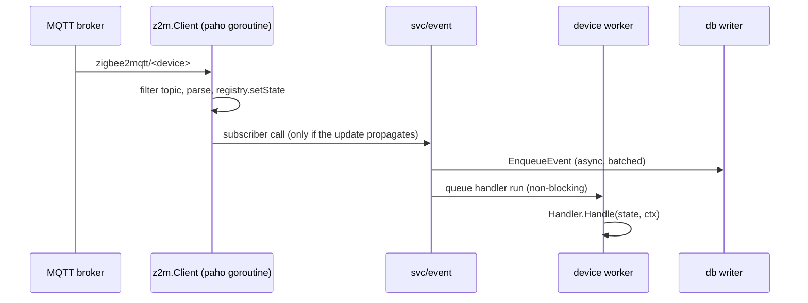

# Architecture

Homeland is one Go process: it connects to the Zigbee2MQTT broker, keeps every device's latest state in memory,
runs the user's JavaScript scripts on device updates and cron schedules, stores every event in SQLite, and serves a
JSON API and the UI. This page is the map for contributors; [`script.d.ts`](script.d.ts) is the contract for script
authors.

## Packages

```
cmd/server            entrypoint: loads config, builds web/context, serves until SIGINT/SIGTERM, shuts down
internal/
  config              environment-only configuration
  mqtt                generic paho client (no Zigbee2MQTT knowledge)
  mqtt/mqtttest       test-only: broker-less fake client, loopback fake broker
  z2m                 Zigbee2MQTT client: device registry, state filtering, publish, update fan-out
  script              goja runtime: load and compile scripts, the ctx SDK, Handler (Handle/RunJob)
  svc/scripts         compiled-handler cache keyed by device id, optional file watcher, external broker
  svc/event           device-update subscriber: stores events, runs handlers on per-device workers
  svc/scheduler       gocron jobs for the jobs scripts export
  db                  SQLite event store: batched writer, queries, retention
  healthcheck         composable health tree
  web, web/api        Fiber server, middleware, JSON API under /api/v1
  web/context         dependency container: builds, starts and stops everything
```

Dependencies point one way: `mqtt` ← `z2m` ← `script` ← `svc/scripts` ← `svc/event`, `svc/scheduler` ←
`web/context` ← `web/api`, `web` ← `cmd/server`. `config`, `db` and `healthcheck` are leaves. Services receive
their dependencies, often as small interfaces declared by the consumer (`z2m.MQTTClient`, `event.Handlers`,
`event.Z2M`, `scheduler.Scripts`); only `web/context` constructs, connects and closes them. API handlers read from
`web/context.Context` and hold no business logic.

## A device update, end to end



1. **Filtering** (`z2m`). The client subscribes to `#` under the base topic. The base topic itself, bridge topics it
   doesn't use, command topics (`set`, `get`), `availability` and empty payloads are ignored; the `device` and
   `update` keys are stripped from state. `action` is an event, not state, so it is stripped from retained copies,
   which the broker resends on every reconnect: their press already happened.
2. **Propagation** (`z2m/registry.go`). A device's first state is stored but not passed on: it is the initial
   sync-up from retained messages. State that arrives before `bridge/devices` is moved to the device's IEEE address
   once the roster arrives. A state missing a primary attribute of the device's schema (`action` only when it is
   the sole one, as on a remote), or one that repeats the previous state (ignoring `last_seen`, `linkquality` and
   `action`; a state with `action` is never a repeat), is dropped.
3. **Storage** (`db`). The event is queued for one background writer that inserts up to 100 rows per statement and
   flushes at least every 250ms. A full queue (1024) blocks rather than losing events.
4. **Handler run** (`svc/event`). The run is queued on the device's own worker goroutine, so scripts never run on the
   paho goroutine. A device's runs happen in order; devices run in parallel. A device's queue holds 64 runs; when it
   is full, new updates for that device are dropped and logged.

## Scripts

- A script is `<device-id>.js` in `HL_SCRIPTS_DIR`, where the id is a friendly name or an IEEE address. It runs as
  the body of a strict-mode CommonJS-style function and sets `module.exports = { handle, jobs }`.
- `svc/scripts` compiles every script at startup into a `script.Handler`, each with its own goja runtime. Script
  mistakes (syntax errors, a top-level throw, invalid exports or cron expressions, more than `script.MaxJobs` (20)
  jobs) produce a *broken handler* that runs nothing and is shown in the API and UI; they never stop the service.
- `Handle` and `RunJob` on one handler are serialized by its mutex, and `HL_SCRIPTS_TIMEOUT` interrupts any run.
- With `HL_SCRIPTS_WATCHER=true`, file changes are debounced per file and synced from disk. Handler changes fan out
  through `svc/scripts.Subscribe`; the scheduler is the subscriber that keeps gocron jobs in sync.
- A device may have only one script. When it has one under both its ids, `svc/scripts.Service.Handler` returns a
  broken handler naming both files, and the scheduler skips their jobs.

## Lifecycle

Every service follows `New` (no I/O) → `Subscribe` → `Start` → `Shutdown`, and a producer starts only after its
consumers are wired. `cmd/server` loads the config and passes it to `web/context.New`, which opens the DB, builds
the z2m client, builds the services, then starts the event service, `svc/scripts`, the scheduler, and connects the
broker last. If a step fails, everything built so far is shut down. A broker that is down is not a failure: `Connect` returns at once, paho retries every 10s until it
connects (logging each failure), and the health check reports the connection as down meanwhile. A lost connection
is retried with exponential backoff from 1s, capped at 1m; neither loop gives up.

Shutdown runs in reverse, driven by `cmd/server`: HTTP stops first (10s timeout), then the scheduler and the event service (each waits for
runs in progress; queued handler runs are dropped), then the z2m connection, `svc/scripts` (watcher and external
broker), and the database last, after the event writer has drained its queue.

## Concurrency at a glance

| Goroutine | Runs |
| --- | --- |
| paho delivery | topic filtering, registry update, z2m subscribers (`svc/event`: enqueue only) |
| one per device (`svc/event`) | that device's `handle` calls, in order |
| gocron | scheduled jobs (singleton: a tick during the previous run is skipped) |
| `svc/scripts` watcher | debounced recompiles and scheduler sync |
| db event writer | batched inserts |
| db retention | pruning and incremental vacuum |
| Fiber | HTTP requests (read-only access to the registry, cache and DB) |

## Persistence and HTTP

- The `events` table holds the IEEE address, the JSON payload and `created_at` (always UTC, because SQLite compares
  times as strings). Migrations in `internal/db/migration.go` are append-only.
- Retention prunes by age and/or a per-device cap in small batches, so inserts get in between.
- The API is documented in the [README](../README.md#http-api). It has no authentication and exposes device state,
  event history and script sources: it is meant for a trusted LAN.
